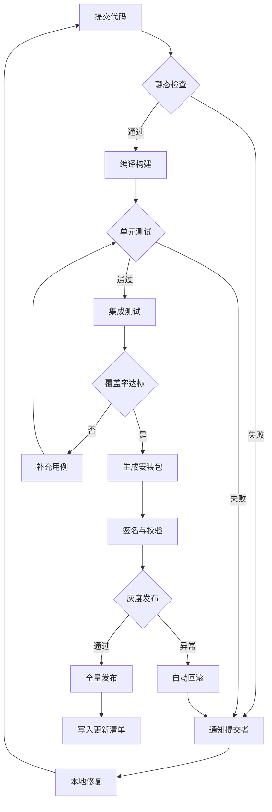
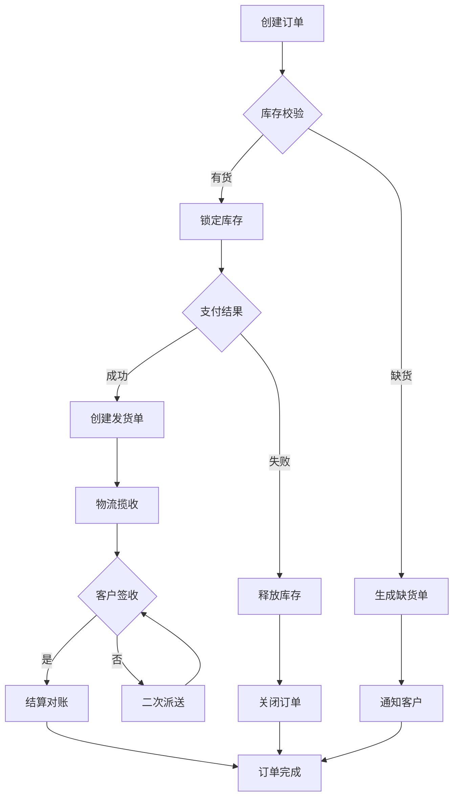
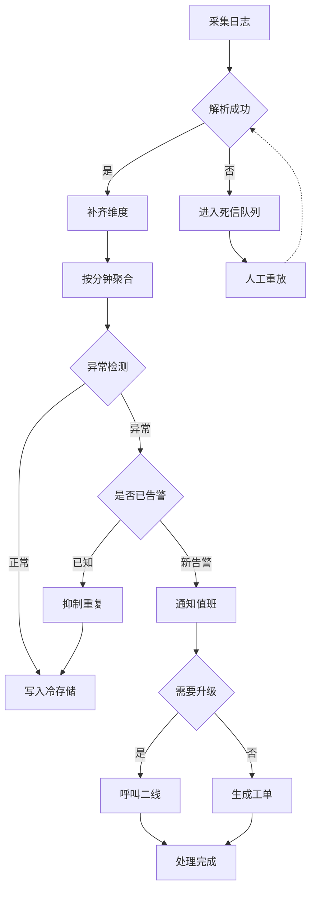

# GPUI Markdown 渲染验证

这份文档用于验证 `gpui-kit-markdown-extras` 的可用性：三张足够复杂的流程图覆盖分层、扇出、扇入、回边、菱形判断与边标注；公式覆盖日常统计、校准曲线与常见数学记号。

> 文档里的流程图与公式都由本 crate 在 GPUI 里原生绘制，不依赖浏览器或图片资源。

---

## 1 公式

### 1.1 行内公式

质能方程 $E = mc^2$；勾股定理 $a^2 + b^2 = c^2$；圆周率 $\pi \approx 3.1416$。

样本量 $n$ 与第 $i$ 个观测值 $x_i$ 构成序列 $x_1, x_2, \ldots, x_n$；当 $n \to \infty$ 时，$\bar{x}$ 依概率收敛到 $\mu$。

判断条件：$1 \le i \le n$ 且 $i \ne j$；误差范围 $\pm 5\%$；相关系数 $r \ge 0.99$ 视为线性良好。

### 1.2 描述统计

均值、样本标准差与变异系数：

$$\bar{x} = \frac{1}{n}\sum_{i=1}^{n} x_i$$

$$s = \sqrt{\frac{\sum_{i=1}^{n}\left(x_i - \bar{x}\right)^2}{n - 1}}$$

$$CV = \frac{s}{\bar{x}} \times 100\%$$

偏倚（相对偏差）：

$$Bias\% = \frac{\bar{x} - \mu}{\mu} \times 100\%$$

### 1.3 相关与回归

皮尔逊相关系数——长分式里套两个求和与一个双层根号：

$$r = \frac{\sum_{i=1}^{n}\left(x_i - \bar{x}\right)\left(y_i - \bar{y}\right)}{\sqrt{\sum_{i=1}^{n}\left(x_i - \bar{x}\right)^2 \sum_{i=1}^{n}\left(y_i - \bar{y}\right)^2}}$$

最小二乘直线 $y = ax + b$，其中斜率与截距为：

$$a = \frac{\sum\left(x_i - \bar{x}\right)\left(y_i - \bar{y}\right)}{\sum\left(x_i - \bar{x}\right)^2}, \quad b = \bar{y} - a\bar{x}$$

### 1.4 校准曲线

四参数 Logistic（4PL）曲线：

$$y = \frac{A - D}{1 + \left(x / C\right)^{B}} + D$$

切线近似与稀释回收率：

$$y \approx y_0 + k\left(x - x_0\right), \quad R = \frac{c_{\text{实测}}}{c_{\text{理论}}} \times 100\%$$

### 1.5 数学记号

二次方程求根（覆盖 `\frac` + `\sqrt` + 上标）：

$$x = \frac{-b \pm \sqrt{b^2 - 4ac}}{2a}$$

嵌套分式与嵌套根号：

$$\frac{\frac{a}{b}}{\frac{c}{d}} \quad \text{与} \quad \sqrt{1 + \sqrt{1 + \sqrt{1 + x}}}$$

求和、连乘、定积分：

$$\sum_{i=1}^{n} x_i \quad \prod_{k=1}^{m}\left(1 + \lambda_k\right) \quad \int_{0}^{1} f(x)\,dx$$

一维波动方程（偏导数与拉普拉斯算子）：

$$\frac{\partial^2 u}{\partial t^2} = c^2 \nabla^2 u$$

集合与逻辑：

$$A \subseteq B \Rightarrow \forall x \in A,\; x \in B, \quad A \cup B \ne \emptyset$$

希腊字母与常用符号：

$$\alpha + \beta = \gamma, \quad \mu \pm \sigma, \quad \Delta \approx 0, \quad \Omega \to \infty, \quad \hat{y} \pm \tilde{\varepsilon}$$

### 1.6 表格中的公式

| 指标 | 公式 | 判定线 |
|---|---|---|
| 均值 | $\bar{x} = \frac{1}{n}\sum x_i$ | — |
| 标准差 | $s = \sqrt{\frac{\sum (x_i-\bar{x})^2}{n-1}}$ | 越小越稳 |
| 变异系数 | $CV = \frac{s}{\bar{x}} \times 100\%$ | $CV \le 15\%$ |
| 相关系数 | $r$ | $r \ge 0.99$ |
| 偏倚 | $Bias\% = \frac{\bar{x}-\mu}{\mu} \times 100\%$ | 绝对值 ≤ 10% |

---

## 2 流程图

### 2.1 发布流水线（扇出 / 扇入 / 三段回边）

从静态检查一路到更新清单：失败分支回到「通知提交者」形成扇入，修复后回到起点形成外层循环，覆盖率不足回到单元测试形成内层循环。



### 2.2 订单履约（多路汇聚）

下单后按库存分两条路，支付失败要释放库存并关单；签收不通过会回到「签收」重新判定；缺货单与关单最后都汇入订单完成。



### 2.3 日志告警（长回退边 + 虚线）

采集、解析、聚合、检测、去重、分级通知；死信人工重放回到解析，重复告警直接落库形成长回退边。



---

## 3 其他 Markdown 元素

### 3.1 列表

1. 有序列表第一项
2. 第二项，含行内代码 `with_plugins(TextView::markdown(id, md))`
3. 第三项

- 无序项 A
- 无序项 B
  - 嵌套项 B.1
  - 嵌套项 B.2

### 3.2 引用与代码块

> 引用块用来放结论或注意事项：公式与流程图都是原生元素，可随主题变色，也可以被选中复制。

```rust
use gpui_kit::component::text::TextView;
use gpui_kit_markdown_extras::with_plugins;

with_plugins(TextView::markdown("doc", SOURCE)).selectable(true)
```

### 3.3 强调

**加粗**、*斜体*、~~删除线~~、`行内代码`、[链接](https://gpui-kit.com)。
