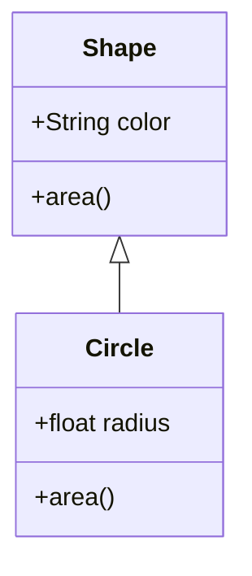
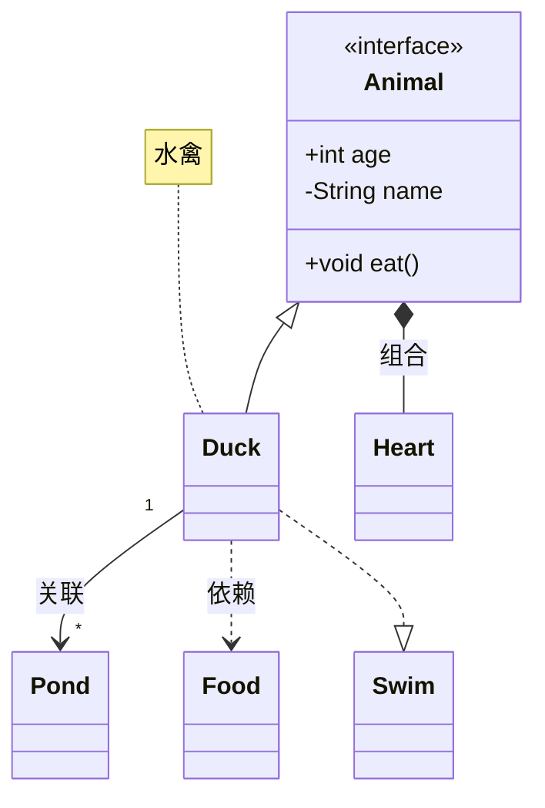
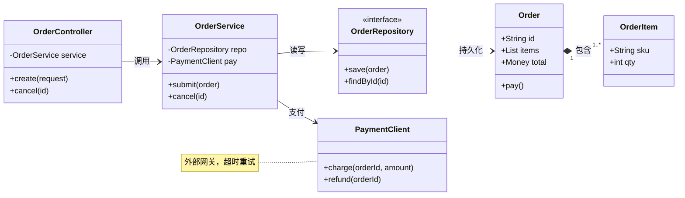
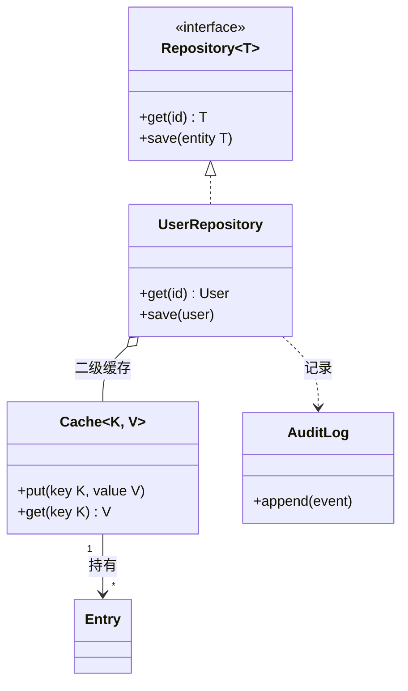

# 类图

Mermaid `classDiagram` 的四张示例：类成员、注解、七类关系、多重度与注释，类框高度随成员行数变化。

## 1 基础：继承

一个父类、一个子类，最直接的继承关系。

## 2 中等：关系符号集合

继承、组合、关联、依赖、实现各有不同端点符号，多重度写在两端，注释用虚线框。

## 3 复杂：三层服务架构

横向排布的多层调用链，接口注解写在类块内，仓库与实体之间用依赖虚线。

## 4 进阶：泛型与聚合

泛型类名用 `~` 标注（ID 取 `~` 前的部分），实现关系与聚合空心菱形。

