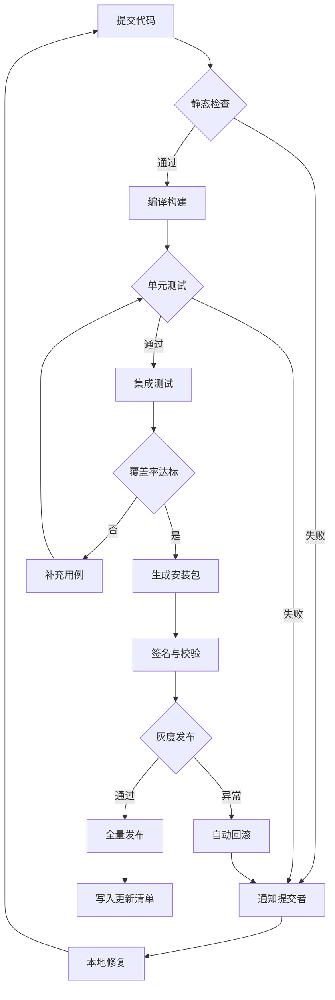
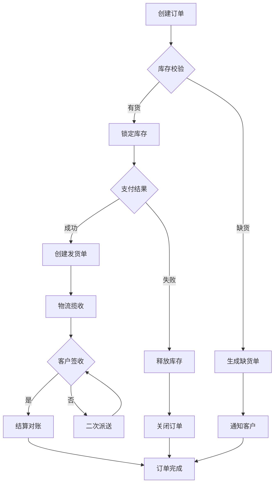
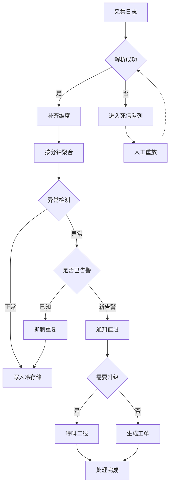

# 流程图

Mermaid `flowchart` 的三张示例，由浅入深覆盖分层、扇出、扇入、回边、菱形判断与边标注，全部由 GPUI 原生绘制。

## 1 发布流水线（扇出 / 扇入 / 三段回边）

从静态检查一路到更新清单：失败分支回到「通知提交者」形成扇入，修复后回到起点形成外层循环，覆盖率不足回到单元测试形成内层循环。

## 2 订单履约（多路汇聚）

下单后按库存分两条路，支付失败要释放库存并关单；签收不通过会回到「签收」重新判定；缺货单与关单最后都汇入订单完成。

## 3 日志告警（长回退边 + 虚线）

采集、解析、聚合、检测、去重、分级通知；死信人工重放回到解析，重复告警直接落库形成长回退边。

