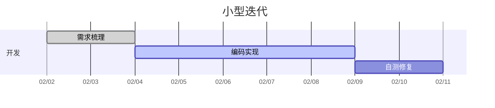
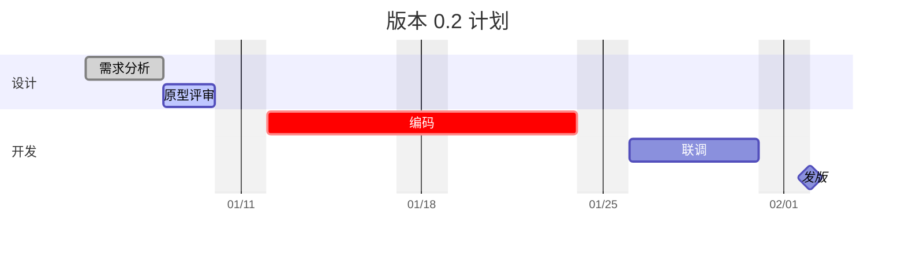
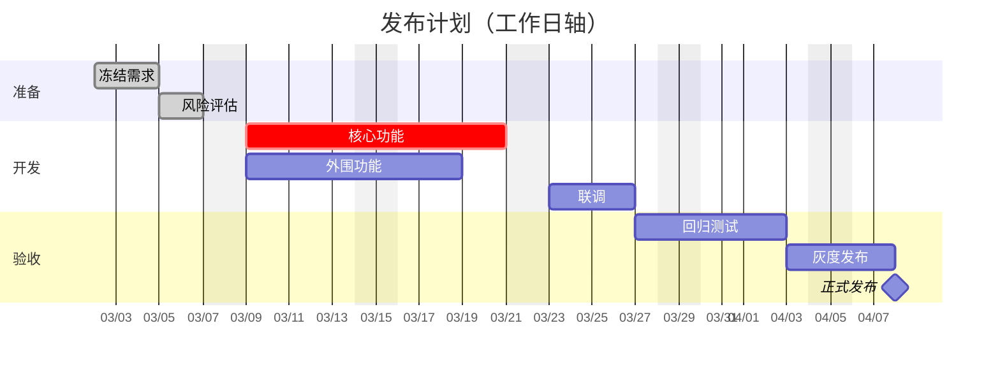
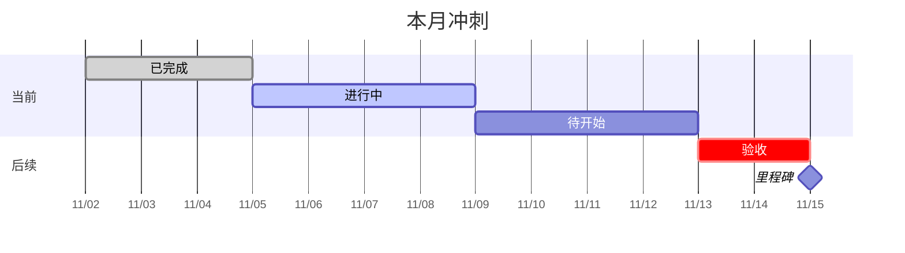

# 甘特图

Mermaid `gantt` 的四张示例：`done` / `active` / `crit` 用主题语义色区分，里程碑画菱形，`excludes weekends` 会把时间轴压成工作日。

## 1 基础：小型迭代

单 section，显式日期与时长，三种任务状态各一条。

## 2 中等：多段计划与里程碑

两个 section，用 `after` 串联依赖，最后以里程碑收尾。

## 3 复杂：工作日排期

`excludes weekends` 去掉周末，`crit` 标出关键路径，联调依赖两个前序任务。

## 4 进阶：今日标记

不关 `todayMarker`，时间轴落在本月，竖线标出当天；进行中的任务用 `active` 高亮。

