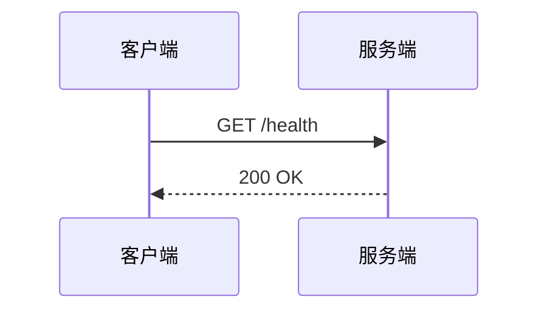
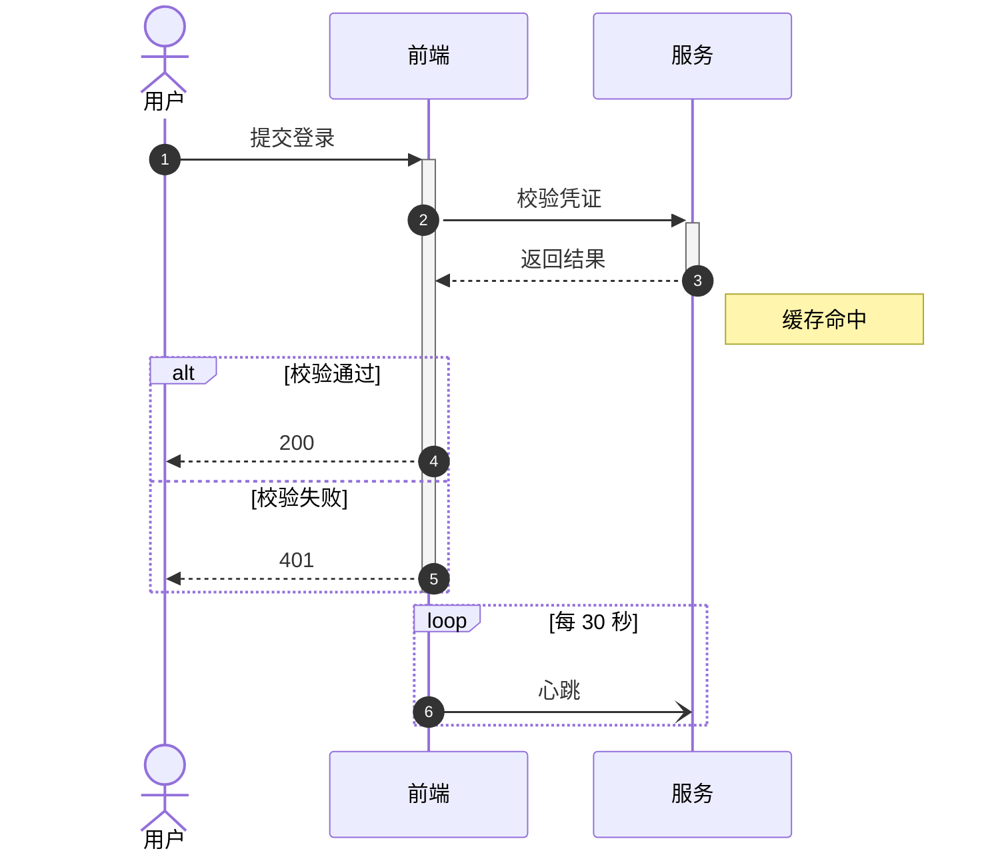
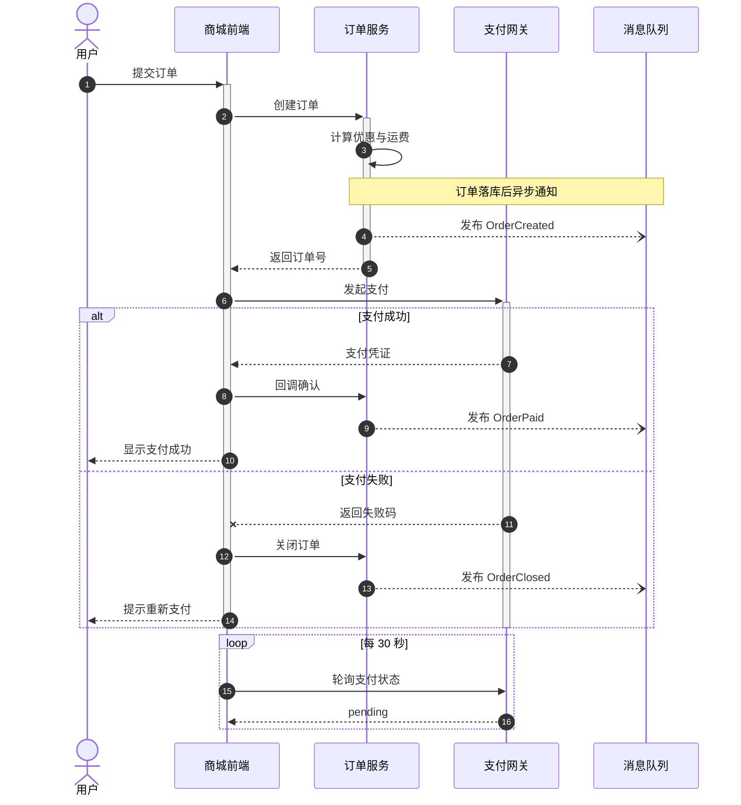
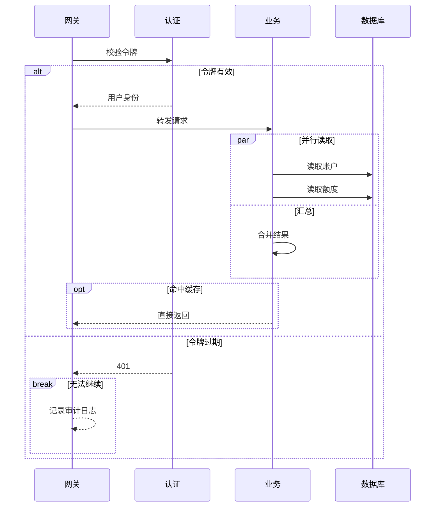
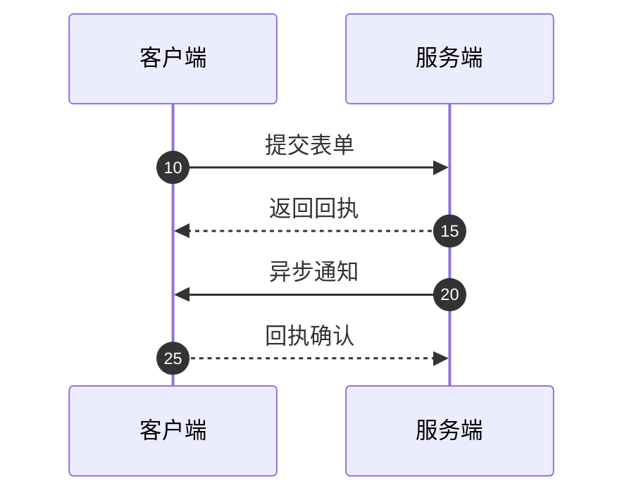
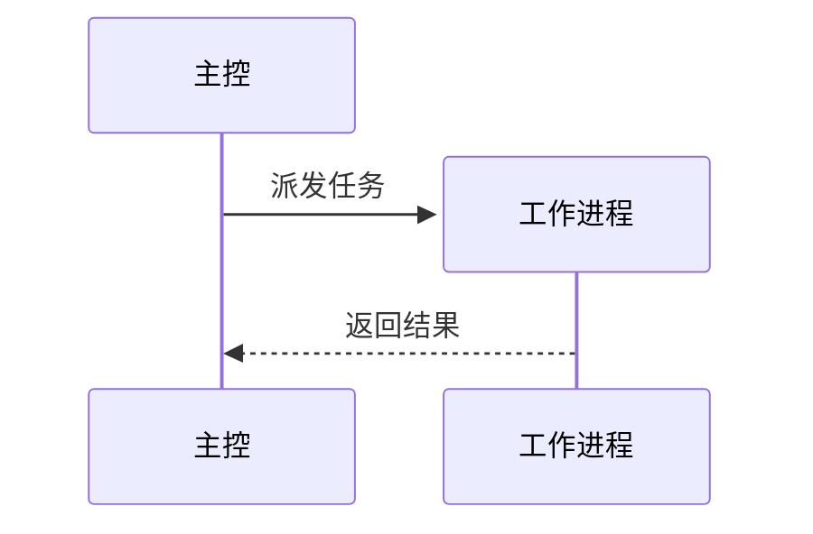

# 时序图

Mermaid `sequenceDiagram` 的六张示例：参与者、消息、激活框、注释与组合片段（`alt` / `else` / `opt` / `par` / `loop` / `break`），以及带起始 / 步长的 `autonumber` 与 `create` / `destroy`，都由 GPUI 原生绘制。

## 1 基础：请求与响应

两个参与者、一来一回，最小时序图。

## 2 中等：登录校验

`autonumber` 编号、`+`/`-` 激活框、注释、`alt` / `else` 分支与 `loop` 循环。

`+` 激活箭头右侧的接收方，`-` 关闭箭头左侧的发送方，必须成对出现；也可以像末尾那样用 `activate` / `deactivate` 显式配对。

## 3 复杂：下单支付

自发消息、`Note over`、异步消息 `-)`、失败叉号 `--x`，以及 `alt` 包裹的主成功 / 失败分支。

## 4 进阶：嵌套片段

`alt` 里嵌 `par` / `opt`，失败分支再用 `break` 提前退出，验证多层片段框与分隔线。

## 5 编号起始 / 步长

`autonumber 10 5` 从 10 起、每条 +5（10 / 15 / 20 / 25），适合给消息编号留出间隔或从指定值开始。

## 6 动态创建与销毁

`create participant W as 工作进程` 让参与者中途登场，`destroy W` 标记销毁（生命线画叉，但参与者不会被移除）。

