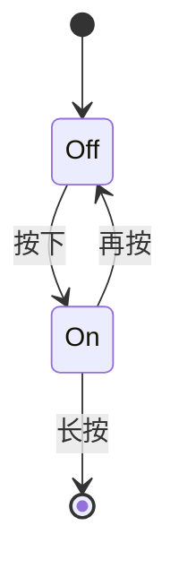
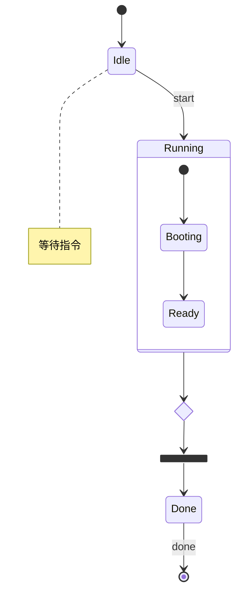
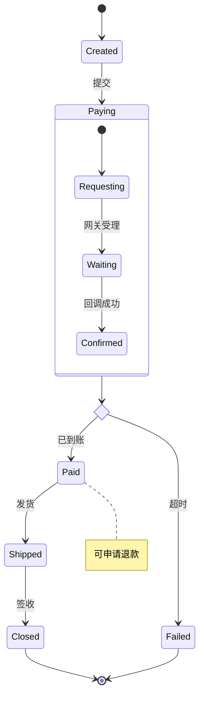
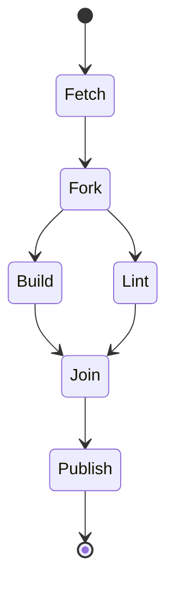
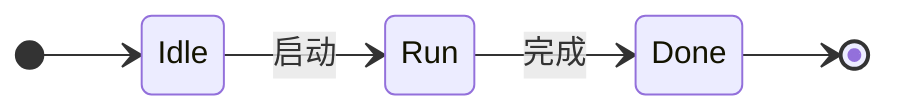
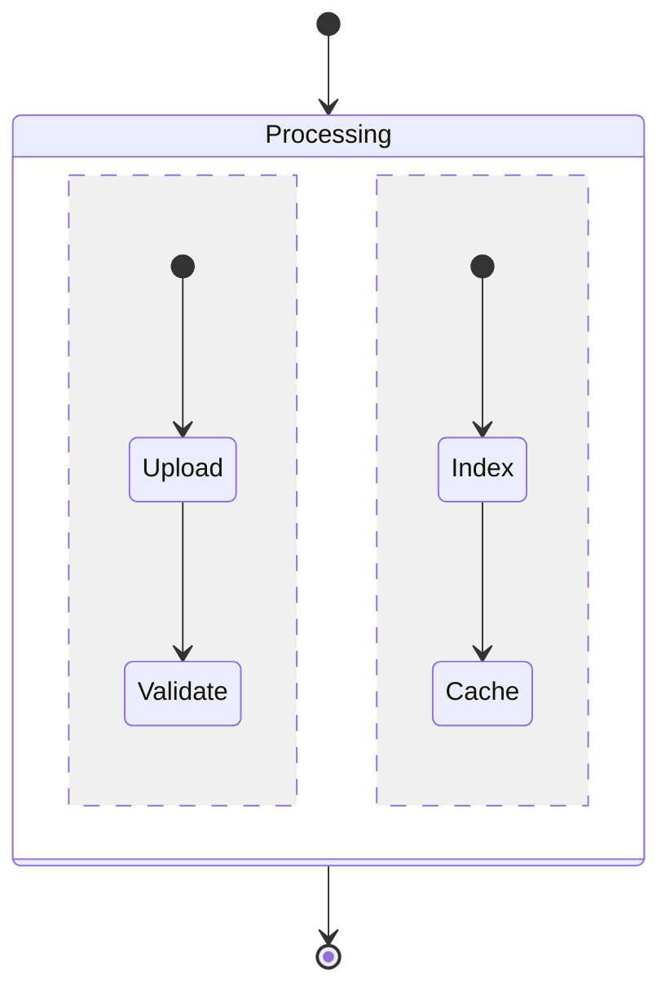

# 状态图

Mermaid `stateDiagram-v2` 的六张示例：`[*]` 起止圆、`<<choice>>` 空心菱形、`<<fork>>` / `<<join>>`（有名字画成节点，只有内部标识符才画成同步条）、带标题栏的复合状态与注释，以及 `direction` 方向、冒号描述与 `--` 并发区域。

## 1 基础：开关

两个状态、一条回边，外加一个终止状态。

## 2 中等：复合状态与选择

`Running` 内部有自己的起止（成员名省掉 `Running::` 前缀）；`check` 是空心菱形，`fork1` 这种内部标识符才画成同步条。

## 3 复杂：订单状态机

多个复合状态与选择分支，失败与完成各自走到独立终止圆。

## 4 进阶：分叉与汇合

`fork` 把一条流转拆成并行两支，`join` 再把它们同步汇合，最后发布并结束。两个名字都是有意义的词，因此画成带名字的状态节点，而不是一条光秃秃的同步条。

## 5 方向与冒号描述

`direction LR` 把状态机转成横向；`state Idle: 空闲` 用冒号给状态起显示名（内部仍按 `Idle` 连线），描述与方向可叠加。

## 6 并发区域（`--`）

复合状态里用独立成行的 `--` 分出两条并发链，各自有起止，外框包住全部成员并紧贴标题栏。

